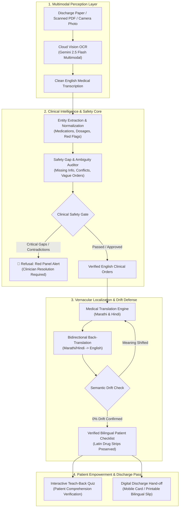

# 🛡️ DischargeGuard

> **Autonomous Clinical Discharge Safety Gatekeeper & Multilingual Patient Empowerment Engine**  
> *Built for the RBU Google Hackathon • Powered by Google Gemini 2.5 Flash Multimodal Vision*

[](https://share.streamlit.io/)
[](https://aistudio.google.com/)
[](LICENSE)
[-059669)](#-100-free-architecture-zero-cost--zero-model-downloads)
[](#-two-stage-clinical-pipeline)

---

## 📌 Executive Summary & Problem Statement

### The Clinical Crisis at Hospital Discharge
Hospital discharge is the most perilous transition in patient care:
* **Preventable Readmissions & Adverse Drug Events:** Globally and in developing healthcare ecosystems like India, **18% to 24% of patients suffer an adverse event within 30 days of discharge**. More than **60% of these incidents are entirely preventable**, stemming from misunderstood prescriptions, missed medication schedules, or unmonitored post-surgical red flags.
* **The Vernacular Disconnect:** Physicians document discharge summaries in dense English medical shorthand (*“Tab Metformin 500mg BD PC”, “SOS PCM 650mg”, “Taper Prednisolone weekly”*). Yet over **75% of patients and family caregivers** in state and district hospitals speak and read regional languages (e.g., **Marathi**, **Hindi**). Intimidated by the hospital environment, families nod politely and leave without understanding life-critical instructions.
* **The "Teach-Back" Vacuum:** Overstretched hospital staff have an average of **2 to 4 minutes** per discharge hand-off. There is zero time or structured mechanism to verify whether the caregiver actually understands how and when to take high-risk medications.
* **Messy Physical Documents:** Real-world discharge summaries are frequently physical papers: carbon copies, low-resolution dot-matrix printouts, or typed sheets with scribbled doctor annotations and stamps in the margins.

**DischargeGuard** resolves this crisis by acting as an **Autonomous Clinical Gatekeeper**: ingesting paper prescriptions via **Cloud Vision OCR**, auditing clinical ambiguities and omissions in English, localizing instructions into **Marathi & Hindi** with zero hallucination, and verifying caregiver comprehension via an **Interactive Teach-Back Quiz**.

---

## 🎨 Evidence-Based Color Psychology: Soothing Cool Tones (Calm & Recovery)

DischargeGuard's interface is intentionally engineered using healthcare-backed **biophilic color psychology** to alleviate clinical anxiety, foster recovery, and combat cognitive fatigue:

| Color Palette | Clinical Rationale & Psychological Effect |
| :--- | :--- |
| **Serene Blues** (`#F0F9FF`, `#BAE6FD`, `#0284C7`, `#0369A1`) | Sky and serene blues naturally trigger the physiological release of calming hormones. Hospital studies prove that blue tones lower post-treatment anxiety, stabilize blood pressure, and ease perception of chronic pain in patient recovery environments. |
| **Healing Greens** (`#F0FDF4`, `#ECFDF5`, `#A7F3D0`, `#059669`) | Soft sage, mint, and seafoam greens evoke nature and cellular equilibrium. Green is the most restful spectrum for human ocular photoreceptors, promoting cellular renewal, psychological comfort, and a grounded sense of security. |
| **Gentle Coral Alert** (`#FFF1F2`, `#FECDD3`, `#9F1239`) | High-priority safety warnings ("Red Panel") are softened from aggressive harsh reds into soothing rose-coral cards. This commands immediate clinical attention without inducing panic or stress in caregivers. |

---

## 🚀 Key Innovations & Core Capabilities

```
+---------------------------------------------------------------------------------------------------------+
|                                           DischargeGuard 2.0                                            |
+---------------------------------------------------------------------------------------------------------+
| [1. Perception]        Cloud Vision OCR (Gemini 2.5 Flash): Photos, Camera Snaps & Scanned PDFs        |
| [2. Clinical Core]     English-First Medical Reasoning (Preserves standard INN & shorthand OD/BD/TID)  |
| [3. Safety Gate]       "Red Panel" Safety Audit: Catches missing doses, drug conflicts, vague orders   |
| [4. Localization]      Zero-Hallucination Marathi & Hindi with Latin Blister-Pack Preservation         |
| [5. Drift Defense]     Bidirectional Back-Translation (Marathi/Hindi -> English) with Drift Scoring    |
| [6. Patient Loop]      Interactive Dynamic Teach-Back Quiz + Comprehension Verification                 |
+---------------------------------------------------------------------------------------------------------+
```

### 1. Multimodal Document Ingestion (Cloud Vision OCR)
* **Drag-and-Drop Uploader:** Supports `.png`, `.jpg`, `.jpeg`, `.webp`, and `.pdf` files.
* **Live Camera Capture:** Nurses or doctors can use their smartphone or webcam to instantly snap paper discharge sheets.
* **Gemini 2.5 Flash Cloud Vision:** Transcribes printed text, tables, and handwritten cursive notes directly in the cloud without requiring local GPU hardware.
* **Deterministic Caching:** Uses SHA-256 byte hashing to prevent redundant API calls on identical documents.

### 2. The "English-First, Vernacular-Downstream" Principle
* Medical abbreviations (`OD`, `BD`, `TID`, `SOS`, `AC`, `PC`), chemical compounds, and dosage rules are standardized in English.
* All entity extraction, dosage auditing, and Red Panel conflict detection happen **exclusively in English first**, preventing mistranslation bugs or hallucinated drug interactions.

### 3. The "Red Panel" Clinical Safety Gatekeeper
* Automatically flags:
  * **Vague instructions** (e.g., *"take when needed"* without a maximum daily threshold).
  * **Missing critical care protocols** (e.g., diabetic patient on insulin without hypoglycemia emergency sugar instructions).
  * **Dosage / Frequency ambiguities** or conflicting medication schedules.
* **Refusal-to-Generate Gatekeeper:** If a note is dangerously incomplete or contradictory, DischargeGuard refuses checklist generation, displaying an explicit clinical alert instructing the nurse to seek attending physician clearance.

### 4. Zero-Hallucination Localization with the "Blister-Pack Rule"
* Instructions are translated into spoken colloquial **Marathi** and **Hindi** in clean Devanagari script.
* **The Blister-Pack Rule:** Drug names, dosages, units, and numbers remain in English/Latin characters (*e.g., "Metformin 500mg"*). Patients can visually match the text on their checklist directly to the physical tablet foil.
* **100% Traceability:** Every vernacular item is mathematically anchored to a verbatim English source quote from the original document.

### 5. Bidirectional Back-Translation Drift Defense
* The system performs automated reverse-translation (Marathi $\rightarrow$ English, Hindi $\rightarrow$ English).
* A clinical semantic validator compares original vs. back-translated text to ensure zero clinical meaning shift before the patient departs.

### 6. Interactive Teach-Back Patient Quiz
* Overcomes the 2-minute discharge limitation by dynamically generating scenario-based multiple-choice questions in Marathi/Hindi.
* Tests high-risk comprehension (e.g., *"When should you take Metformin 500mg?"* or *"What must you do if you notice persistent high fever?"*).
* Real-time scoring and encouraging feedback guide the patient or notify hospital staff if re-counseling is required.

---

## 🏗️ System Architecture & Data Flow



---

## 💰 100% Free Architecture (Zero Cost & Zero Model Downloads)

DischargeGuard is engineered for immediate hackathon evaluation and resource-constrained public hospital pilots without budget or hardware barriers:

| Layer | Technology | Why It Costs $0.00 & Requires No Heavy Downloads |
| :--- | :--- | :--- |
| **Hosting & UI** | **Streamlit Community Cloud** (`share.streamlit.io`) | Free forever, zero server management, deploys directly from GitHub in 60 seconds. |
| **Multimodal Vision & OCR** | **Google Gemini 2.5 Flash** | Cloud-native vision. **No need to download 3–5 GB of PyTorch, CUDA, or OCR model weights.** |
| **Clinical Reasoning & Safety** | **Google AI Studio Free Tier** | Generous free developer quota of **15 Requests/Min (RPM) and 1,500 Requests/Day (RPD)**. No credit card required. |
| **Localization & Drift Defense** | **Google Gemini 2.5 Flash** | High-fidelity Marathi and Hindi Devanagari translation included in the free tier. |

---

## ⚡ Quick Start Guide

### Option 1: Run Locally

1. **Clone the repository:**
   ```bash
   git clone https://github.com/tanvir-kanoje/Discharge-Guard.git
   cd "Discharge-Guard"
   ```

2. **Create and activate a virtual environment:**
   ```bash
   python3 -m venv .venv
   source .venv/bin/activate  # On Windows: .venv\Scripts\activate
   ```

3. **Install the lightweight dependencies:**
   ```bash
   pip install -r requirements.txt
   ```

4. **Set your free Gemini API Key:**
   Get a free key from [Google AI Studio](https://aistudio.google.com/):
   ```bash
   export GEMINI_API_KEY="your_api_key_here"
   export GEMINI_MODEL="gemini-2.5-flash"
   ```
   *(Or enter it directly in the app sidebar at runtime.)*

5. **Launch the application:**
   ```bash
   streamlit run app.py
   ```

---

### Option 2: Deploy to Streamlit Community Cloud (3 Minutes)

1. Fork or push this repository to your personal GitHub account.
2. Visit **[share.streamlit.io](https://share.streamlit.io/)** and sign in with GitHub.
3. Click **"New app"** $\rightarrow$ select `Discharge-Guard`, branch `main`, file `app.py`.
4. Under **Advanced settings $\rightarrow$ Secrets**, add:
   ```toml
   GEMINI_API_KEY = "your_actual_gemini_api_key"
   GEMINI_MODEL = "gemini-2.5-flash"
   ```
5. Click **"Deploy!"** Your application will be live at a public URL for evaluators.

---

## 📂 Repository Structure

```
Discharge-Guard/
├── app.py                     # Streamlit clinical UI with Serene Blue / Healing Green styling
├── pipeline.py                # Core pipeline: Cloud Vision OCR, extraction, safety audit, localization
├── schemas.py                 # Pydantic data schemas enforcing strict output contracts
├── requirements.txt           # Minimal, lightweight dependencies (streamlit, google-genai, pydantic, pillow)
├── .streamlit/
│   └── config.toml            # Biophilic healing theme color configuration
├── prompts/
│   ├── translate.md           # Marathi vernacular translation prompt with Latin script preservation
│   └── translate_hindi.md     # Hindi vernacular translation prompt
├── docs/
│   ├── ARCHITECTURE_AND_DESIGN.md # Comprehensive engineering & clinical specification
│   ├── SPEC.md                # System goals, non-goals, and success metrics
│   └── SAFETY.md              # Decision-support policies and clinical refusal conditions
└── samples/                   # Synthetic discharge summaries with planted traps for testing
    ├── good_with_traps.txt    # Note with planted vagueness and missing instructions
    ├── too_vague.txt          # Note designed to trigger safety refusal
    └── expected.json          # Gold-standard validation schema
```

---

## ⚖️ Clinical Safety & Ethical Governance

> [!IMPORTANT]
> **Decision-Support Only:** DischargeGuard is designed strictly as a clinical decision-support co-pilot. An attending physician or registered nurse must review and approve all outputs before patient discharge hand-off.
>
> * **Zero Hallucination Tolerance:** No instruction is presented to the patient unless it possesses a verbatim source quote in the input note.
> * **Automatic Refusal:** If an input document contains contradictory medication dosages or lacks essential recovery instructions, the system halts generation and issues an urgent clinical alert.
> * **Synthetic Data Testing:** Development and testing are conducted strictly on synthetic, de-identified clinical notes in adherence to patient privacy standards.

---

## 🏆 Hackathon Evaluation Alignment

* **Healthcare Impact:** Directly tackles WHO Patient Safety Challenge #3 (*Medication Without Harm*), bridging the massive English-vernacular health literacy gap in Indian hospitals.
* **Technical Excellence:** Combines cloud-hosted multimodal computer vision (Gemini 2.5 Flash), strict Pydantic JSON contracts, bidirectional back-translation drift defense, and dynamic teach-back synthesis.
* **Human-Centered Design:** Implements evidence-based color psychology (Serene Blues and Healing Greens) to ensure an eye-friendly, calm recovery experience for patients and overburdened clinical staff.
* **Zero Cost & Zero Friction:** 100% free hosting, no local GPU footprint, and 1-click cloud deployment.

---

*DischargeGuard • RBU Google Hackathon • Developed with Google Gemini 2.5 Flash*
