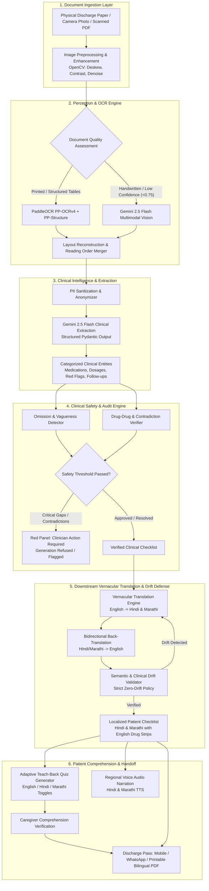

# DischargeGuard: System Architecture, Design & Engineering Specification

## 1. Problem Statement

### 1.1 The Clinical & Healthcare Crisis
Hospital discharge is one of the most hazardous transitions in the entire care continuum. Globally, and specifically in developing healthcare ecosystems like India:
- **18% to 24% of patients** experience an adverse event within 30 days of discharge; **over 60% of these are preventable** and stem directly from medication discrepancies or misunderstood discharge orders.
- **The Vernacular & Health-Literacy Gap:** In multi-lingual countries such as India, doctors document discharge summaries in dense English medical terminology and abbreviations (e.g., *“Tab Metformin 500mg BD PC”, “SOS PCM”, “Taper Prednisolone weekly”*). However, over **75% of patients and family caregivers** in non-metro and public hospitals communicate primarily in regional languages (e.g., Marathi, Hindi, Tamil, Bengali). Patients nod politely during discharge counseling due to intimidation or haste, leaving the hospital without understanding critical self-care instructions.
- **The "Teach-Back" Vacuum:** Overworked hospital staff have an average of **2 to 4 minutes** per patient to explain discharge protocols. There is zero time or structured mechanism to test whether the caregiver actually understands medication timings, dosage safety, warning signs, or dietary contraindications.
- **Illegible & Unstructured Source Documents:** A staggering percentage of discharge documents in district hospitals, charitable trusts, and community health centers are physical papers—often semi-printed, dot-matrix, or containing handwritten doctor notes and scribbled emergency signs.
- **Safety Omissions & Clinical Ambiguity:** Standard discharge notes routinely suffer from omissions (e.g., failing to specify hypoglycemia emergency protocols for insulin, omitting post-op red flags like fever or wound discharge, or providing vague advice like *"review as needed"* without a time-bound milestone).

### 1.3 Two-Stage Architectural Principle: English-First Clinical Reasoning

To eliminate medical hallucinations and comply with clinical standards:
1. **Stage 1 (English Only - Clinical Ground Truth):** All input documents, OCR ingestion, clinical entity extraction, dosage verification, and safety auditing (Red Panel) operate **strictly in English**. This guarantees that medical abbreviations (`BD`, `TID`, `SOS`), international nonproprietary names (INN), and dosage calculations remain uncorrupted by translation artifacts.
2. **Stage 2 (Downstream Vernacular Translation - Hindi & Marathi):** Only after the English clinical checklist passes the safety audit is it translated into **Hindi** and **Marathi**.
   * **The Blister-Pack Rule:** Drug names, dosages, units, and numbers remain in Latin script (e.g., *“Metformin 500mg”*), ensuring the patient can visually match the text on the physical medicine strip.
   * **Dual Verification:** Both Hindi and Marathi outputs undergo independent bidirectional back-translation drift defense and adaptive teach-back quiz synthesis.
1. **Patients & Family Caregivers:** Receive a crystal-clear, verified Marathi checklist, audio-assisted playback, and an interactive teach-back quiz to ensure full comprehension before leaving the hospital premises.
2. **Discharge Nurses & Resident Doctors:** An intelligent co-pilot that audits discharge summaries in real time, detecting omissions, drug conflicts, and vague directives before sign-off.
3. **Hospital Administrators:** Drastic reduction in 30-day readmission rates, lower patient mortality, and protection against medical liability and malpractice disputes.

---

## 2. Elevating DischargeGuard: The 2.0 Innovation Blueprint

To make DischargeGuard a winning healthtech innovation at the Google Hackathon, we transition it from a simple translation utility into an **Autonomous Clinical Safety & Comprehension Gatekeeper**:

| Feature Vector | Basic Prototype | DischargeGuard 2.0 (Award-Winning Vision) |
| :--- | :--- | :--- |
| **Input Modality** | Raw English text pasted into textarea | Physical paper / Scanned PDF / Camera photo / Digital PDF |
| **OCR Architecture** | None (assumes clean digital text) | **Hybrid PaddleOCR + Gemini Multimodal Vision** with automated layout recovery |
| **Safety Engine** | Simple keyword lookup | **Clinical Safety Protocol Engine**: Detects missing emergency advice, drug-drug conflicts, vague intervals, and dosage drift |
| **Traceability** | Partial source quoting | **100% Verbatim Bounding-Box Traceability**: Every Marathi bullet links back to the exact source sentence and image coordinate |
| **Translation Guardrail**| Single-pass translation | **Bidirectional Back-Translation + Clinical Meaning Drift Scorer**: Blocks release if medical meaning drifts |
| **Comprehension Loop** | Static multiple-choice quiz | **Dynamic Teach-Back Engine**: High-risk scenario simulation with regional voice narration (TTS) for non-literate caregivers |
| **Human-in-the-Loop** | Static display | **Clinician Sign-off Dashboard ("Red Panel Gatekeeper")**: Requires clinician resolution of safety gaps before generating the Patient Pass |
| **Export & Delivery** | Web UI only | **WhatsApp Patient Discharge Pass + Printable Dual-Language PDF + QR Code** |

---

## 3. System Architecture & Data Flow



---

## 4. In-Depth Component Specifications & Functions

### 4.1 Ingestion & Preprocessing Layer
- **Functionality:** Ingests JPG, PNG, or multi-page PDF documents. Normalizes skew, eliminates camera shadows, crops borders, and boosts text-to-background contrast.
- **Key Functions:**
  - `preprocess_image(image_bytes: bytes) -> np.ndarray`: Applies grayscale conversion, Otsu thresholding, Gaussian blur, and deskewing via Hough line transforms.
  - `split_pdf_to_images(pdf_bytes: bytes) -> List[np.ndarray]`: Converts multi-page discharge summaries into sequential image frames.

### 4.2 OCR Engine: Connecting with PaddleOCR
PaddleOCR (developed by Baidu) is one of the highest-performing open-source OCR engines for printed text and structured document layouts.
- **Why PaddleOCR?**
  1. **PP-OCRv4:** Delivers 98%+ accuracy on printed English medical text with ultra-fast inference (<150ms on CPU).
  2. **PP-Structure:** Automatically isolates tabular data (vital signs charts, dosage matrices) from freeform clinician text.
  3. **Cost-Effective & Edge-Capable:** Runs on-premise without API fees, satisfying local hospital data isolation requirements.

#### Integration Architecture:
```
Scanned Image 
  ──> OpenCV Preprocessor 
  ──> PaddleOCR (Detection: det_model -> Angle Classifier: cls_model -> Recognition: rec_model) 
  ──> Bounding Boxes & Confidence Scores 
  ──> Line Reconstruction (Spatial Top-to-Bottom, Left-to-Right Sorting) 
  ──> Confidence Audit (<0.75 score routed to Gemini Multimodal fallback)
```

#### PaddleOCR Connection Implementation:
```python
from paddleocr import PaddleOCR
import cv2
import numpy as np
from typing import List, Dict, Any, Tuple

class DischargePaddleOCREngine:
    def __init__(self, use_gpu: bool = False):
        # Initialize PaddleOCR with English detection and angle classification
        self.ocr = PaddleOCR(
            use_angle_cls=True,
            lang='en',
            use_gpu=use_gpu,
            show_log=False
        )
    
    def process_document(self, img_path: str) -> Dict[str, Any]:
        """
        Executes OCR on document image and extracts structured text with spatial metadata.
        """
        img = cv2.imread(img_path)
        # Preprocessing: contrast adjustment
        gray = cv2.cvtColor(img, cv2.COLOR_BGR2GRAY)
        denoised = cv2.fastNlMeansDenoising(gray, h=10)
        
        result = self.ocr.ocr(denoised, cls=True)
        
        extracted_lines = []
        confidences = []
        low_confidence_crops = []
        
        if result and result[0]:
            for line in result[0]:
                bbox, (text, conf) = line
                confidences.append(conf)
                extracted_lines.append({
                    "text": text.strip(),
                    "confidence": float(conf),
                    "bbox": bbox
                })
                # If confidence is below threshold, store crop for Gemini Multimodal verification
                if conf < 0.70:
                    low_confidence_crops.append({"text": text, "bbox": bbox})
        
        # Spatial reconstruction: sort lines by Y-coordinate, then X-coordinate
        sorted_lines = sorted(extracted_lines, key=lambda x: (x["bbox"][0][1] // 15, x["bbox"][0][0]))
        reconstructed_text = "\n".join([item["text"] for item in sorted_lines])
        mean_confidence = float(np.mean(confidences)) if confidences else 0.0
        
        return {
            "full_text": reconstructed_text,
            "mean_confidence": mean_confidence,
            "line_count": len(sorted_lines),
            "requires_multimodal_fallback": mean_confidence < 0.80 or len(low_confidence_crops) > 3,
            "raw_lines": sorted_lines
        }
```

### 4.3 Hybrid Multimodal Fallback (Gemini Multimodal Vision)
When PaddleOCR flags low confidence (e.g. cursive doctor handwriting, stamped signatures, or faded carbon copies), the image is dispatched directly to Gemini 2.5 Flash via the official `google-genai` SDK:
```python
from google import genai
from google.genai import types
from PIL import Image

def extract_via_gemini_multimodal(image_path: str, client: genai.Client) -> str:
    """
    Direct multimodal interpretation of handwritten/complex medical notes.
    """
    img = Image.open(image_path)
    prompt = """
    You are an expert medical records transcription specialist. 
    Transcribe this hospital discharge summary with 100% precision.
    Pay special attention to:
    - Drug names, dosages, routes, and frequencies (e.g., OD, BD, TID, QID, SOS).
    - Emergency warning signs and red flags.
    - Follow-up dates and clinical instructions.
    Do NOT guess. If a handwritten word is completely unreadable, mark it as [ILLEGIBLE_DOCTOR_NOTE].
    """
    response = client.models.generate_content(
        model="gemini-2.5-flash",
        contents=[img, prompt]
    )
    return response.text
```

---

## 5. Gemini API vs. Open-Source LLMs: Deep Comparative Analysis

A critical architectural decision is choosing between **Gemini API** and **Self-Hosted Open-Source Models** (e.g., Llama-3-Med, BioMistral, Gemma 2, Meditron).

| Metric | Google Gemini API (Gemini 2.5 Flash / 1.5 Pro) | Open Source (BioMistral 7B / Llama 3.1 8B via vLLM) |
| :--- | :--- | :--- |
| **Indic Language Translation (Marathi / Hindi)** | **Superior (Tier 1):** Native cultural context, Devanagari script mastery, handles clinical colloquialisms seamlessly. | **Moderate to Poor:** Often produces unnatural literal translations or transliterated gibberish in regional Indian languages. |
| **Multimodal Handwriting Capabilities** | **Native Vision:** Directly ingests scanned images and deciphers messy handwriting without a separate OCR tool. | **Requires External Models:** Requires piping through separate vision adapters (e.g., LLaVA/Pixtral) which struggle on medical charts. |
| **Inference Speed & Latency** | **Sub-second (Gemini 2.5 Flash):** Typically 800ms - 1.5s for end-to-end extraction and translation. | **Hardware Dependent:** 3s - 8s on consumer GPUs; requires dedicated NVIDIA A10G/A100 server. |
| **Context Window** | **1,000,000+ tokens:** Can ingest entire 50-page historical patient hospital records. | **8k - 128k tokens:** Sufficient for single discharge notes, but limits historical chart ingestion. |
| **Infrastructure & Ops Cost** | **Pay-as-you-go:** ~$0.075 per million input tokens. Extremely low cost for hackathon and pilot scale. | **High CapEx/OpEx:** $500 - $1,500/month per GPU instance (AWS g5.xlarge). |
| **Data Privacy & Compliance** | Requires BAA (Business Associate Agreement) or Zero Data Retention agreement for HIPAA/DISHA. | **100% Local Air-Gapped:** Zero data leaves hospital premises (Gold standard for strict offline governance). |

### The Winning Recommendation: The "Edge-Cloud Hybrid" Architecture
1. **Edge Tier (Local):** PaddleOCR + Regex-based PII Masking (redacts patient name, phone, Aadhaar/MRN locally).
2. **Intelligence Tier (Gemini 2.5 Flash):** Receives anonymized clinical text / cropped images. Handles clinical gap auditing, Marathi localization, back-translation drift validation, and teach-back quiz creation.
3. **Offline Fallback Option:** Provide a toggle to switch to a local **Gemma 2 9B** or **Ollama Llama 3.1** instance if deployed in remote rural health posts with zero internet connectivity.

---

## 6. Functional Core: Data Models & Execution Pipeline

### 6.1 Unified Pydantic Schemas (`schemas.py`)
```python
from pydantic import BaseModel, Field
from typing import List, Optional, Literal

class ExtractedClinicalEntity(BaseModel):
    category: Literal["medication", "diet", "activity", "follow_up", "warning_sign", "wound_care"]
    instruction: str
    dosage: Optional[str] = None
    frequency: Optional[str] = None
    duration: Optional[str] = None
    source_quote: str = Field(..., description="Exact verbatim snippet from the discharge note")

class SafetyAuditIssue(BaseModel):
    instruction: str
    source_quote: str
    issue_type: Literal["missing_critical_info", "conflicting_dosage", "vague_instruction", "drug_interaction_risk"]
    severity: Literal["critical", "high", "medium"]
    clinical_risk_rationale: str
    recommended_doctor_clarification: str

class LocalizedChecklistItem(BaseModel):
    english_instruction: str
    marathi_instruction: str
    category: str
    source_quote: str
    time_of_day_icons: List[Literal["morning", "afternoon", "evening", "night", "with_food", "before_food"]]

class SemanticDriftReport(BaseModel):
    original_english: str
    marathi_translation: str
    back_translated_english: str
    drift_detected: bool
    drift_severity: Literal["none", "minor_syntax", "critical_clinical_shift"]
    explanation: Optional[str] = None

class TeachBackQuizQuestion(BaseModel):
    scenario_question_marathi: str
    scenario_question_english: str
    options_marathi: List[str]
    options_english: List[str]
    correct_option_index: int
    critical_explanation_marathi: str
    linked_safety_item: str

class DischargeGuardResult(BaseModel):
    can_generate: bool
    refusal_reason: Optional[str] = None
    hero_safety_issues_count: int
    red_panel_alerts: List[SafetyAuditIssue]
    patient_checklist: List[LocalizedChecklistItem]
    drift_audits: List[SemanticDriftReport]
    teach_back_quiz: List[TeachBackQuizQuestion]
```

### 6.2 Key Operational Functions in `pipeline.py`
1. `run_ocr_pipeline(file_bytes, mode="hybrid") -> str`:
   Routes document through PaddleOCR first; triggers Gemini Multimodal if confidence drops below 80%.
2. `audit_and_extract_clinical_notes(cleaned_text: str) -> Tuple[List[ExtractedClinicalEntity], List[SafetyAuditIssue], bool]`:
   Uses Gemini 2.5 Flash to extract structured clinical entities and simultaneously identify safety traps, ambiguities, and missing protocols.
3. `enforce_safety_gate(issues: List[SafetyAuditIssue]) -> Tuple[bool, Optional[str]]`:
   Evaluates if the discharge note contains disqualifying contradictions (e.g. conflicting insulin dosages) and raises immediate refusal flags.
4. `translate_with_drift_defense(items: List[ExtractedClinicalEntity]) -> Tuple[List[LocalizedChecklistItem], List[SemanticDriftReport]]`:
   Performs forward Marathi translation followed immediately by back-translation into English. If semantic drift score exceeds threshold, re-translates with stricter prompt constraints.
5. `synthesize_teach_back_quiz(checklist: List[LocalizedChecklistItem], issues: List[SafetyAuditIssue]) -> List[TeachBackQuizQuestion]`:
   Focuses questions specifically on high-consequence medications (e.g. anticoagulants, hypoglycemics, antibiotics) to test real comprehension.

---

## 7. User Experience & Clinician/Patient Workflow

```
[DOCTOR / NURSE WORKSTATION]               [PATIENT & CAREGIVER HAND-OFF]
 1. Snap photo of discharge paper           1. View Clean Marathi Checklist (Large 22px Devanagari)
 2. Instant OCR & Clinical Extraction       2. Tap 'Audio' to listen in Marathi
 3. Review "Red Panel" Safety Alerts        3. Caregiver answers 3-Question Teach-Back Quiz
    (e.g., Missing hypoglycemia advice)     4. Instant feedback on misunderstandings
 4. Doctor confirms / modifies in 10s       5. Take home printed bilingual slip + WhatsApp QR pass
 5. One-Click Approval & Stamp
```

---

## 8. Hackathon Evaluation Alignment & Impact Metrics

1. **Innovation & Problem Fit:** Solves a recognized WHO global patient safety target: post-discharge adverse drug events and vernacular health disparities.
2. **Technical Excellence:** Combines on-premise PaddleOCR layout awareness with Google Gemini 2.5 Flash multimodal clinical reasoning and bidirectional back-translation drift defense.
3. **Safety First (Zero Hallucination):** Every output bullet is hard-linked to an exact source quote; automatically halts if contradictions are discovered.
4. **Immediate Scalability:** Ready for deployment in public hospitals (Civil Hospitals, PHCs, AIIMS) and private chains across Maharashtra and wider India.

